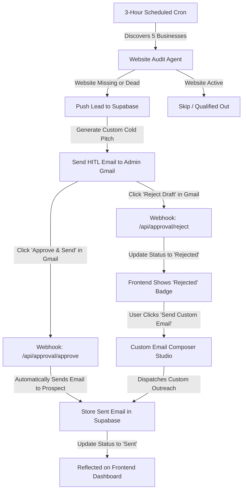

# 🚀 Business Outreach Engine — Autonomous 3-Hour Lead & Email System

A complete full-stack automated prospecting engine built for **Railway** (Backend) and **Vercel** (Frontend), integrated with **Supabase** (Database & Real-time Logs), and powered by **Human-In-The-Loop (HITL) Gmail verification**.

---

## 🏗️ Architecture & Core Workflow



1. **Autonomous 3-Hour Agent (`backend/agent.py` & `backend/scheduler.py`)**:
   - Runs every 3 hours (configurable).
   - Audits 5 local businesses in your chosen niche and target city.
   - Verifies whether each business has an active, reachable website.
   - For businesses with **no website**, generates a high-converting web design proposal pitch tailored to their business.
   - Pushes qualified leads to **Supabase** with status `pending_approval`.
   - Records every step in Supabase logs (`find`, `explore`, `draft`, `approval_pending`).

2. **Human-In-The-Loop (HITL) Gmail Verification**:
   - Sends an interactive HTML approval request to the Admin's Gmail with:
     - Business intelligence (Name, Phone, City, Missing website signal)
     - Drafted pitch proposal
     - **[ ✅ APPROVE & SEND PITCH ]** button (points to Railway webhook `/api/approval/approve?token=...`)
     - **[ ❌ REJECT DRAFT ]** button (points to Railway webhook `/api/approval/reject?token=...`)
   - **If Approved via Gmail**: Backend automatically sends the outreach pitch to the business prospect, records it in the `sent_emails` table in Supabase, and updates lead status to `sent`.
   - **If Rejected via Gmail**: Lead status updates to `rejected` in Supabase. The lead shows up on your web dashboard with a **"Draft Rejected"** badge and a direct **"Send Custom Email"** action!

3. **Custom Email Studio (`frontend/app/custom-email/page.tsx`)**:
   - Dedicated composer on your website to draft and send tailored emails to rejected prospects or follow-ups.
   - All sent custom emails are saved to Supabase `sent_emails` with `sender_type="custom_manual"` and displayed in your dashboard and logs.

4. **Real-Time Telemetry & Logs (`frontend/app/logs/page.tsx`)**:
   - Live stream tracking all execution steps:
     - `FIND`: Scanned candidate businesses in target area
     - `EXPLORE`: Real-time website DNS/HTTP reachability audit
     - `DRAFT`: Proposal email generated
     - `APPROVAL_PENDING`: HITL approval dispatched to Gmail
     - `APPROVED`: Admin clicked approve in Gmail
     - `REJECTED`: Admin clicked reject in Gmail
     - `SENDING`: Email in transit
     - `SUCCESS`: Email successfully delivered
     - `ERROR`: Stack trace and error explanation if anything failed
   - Full JSON payload inspector for each log entry.

---

## 📦 Project Structure

```
Business-Outreach-Engine-MVP/
├── backend/                        # FastAPI Service (Railway Deployable)
│   ├── main.py                     # REST API & Gmail HITL Webhooks
│   ├── agent.py                    # Autonomous Discovery & Website Audit Agent
│   ├── scheduler.py                # APScheduler 3-Hour Automation
│   ├── supabase_client.py          # Supabase Client + Resilient Local Fallback
│   ├── email_service.py            # Gmail HITL & Prospect Email Dispatcher
│   ├── models.py                   # Pydantic Schemas
│   ├── config.py                   # Environment Config
│   ├── test_engine.py              # Pytest End-to-End Test Suite (100% Passed)
│   ├── Dockerfile                  # Railway Docker Deployment
│   ├── railway.json                # Railway Configuration
│   ├── Procfile                    # Railway Procfile
│   └── requirements.txt            # Python Dependencies
├── frontend/                       # Next.js 14 App Router (Vercel Deployable)
│   ├── app/
│   │   ├── layout.tsx              # Root Layout & Theme
│   │   ├── page.tsx                # Dashboard: KPIs, Leads Table, Agent Trigger
│   │   ├── logs/page.tsx           # Real-Time System Activity & Error Logs
│   │   ├── custom-email/page.tsx   # Custom Email Studio with Live Preview
│   │   ├── settings/page.tsx       # Target Niche & Admin Gmail Config
│   │   └── globals.css             # Glassmorphism Design System
│   ├── components/                 # Reusable UI Components
│   ├── lib/api.ts                  # Backend API Client
│   ├── package.json
│   └── vercel.json                 # Vercel Configuration
├── supabase/
│   └── schema.sql                  # Complete SQL Migration Script for Supabase
├── run_backend.bat                 # 1-Click Local Backend Runner
├── run_frontend.bat                # 1-Click Local Frontend Runner
└── test_system.bat                 # 1-Click End-to-End Pytest Runner
```

---

## 🗄️ Supabase Setup (Database & Logs)

1. Go to [Supabase](https://supabase.com) and create a free project.
2. Open the **SQL Editor** in your Supabase project dashboard.
3. Copy the entire contents of [`supabase/schema.sql`](file:///d:/Business-Outreach-Engine-MVP/supabase/schema.sql) and click **Run**.
4. Go to **Project Settings -> API** to copy:
   - `Project URL` (e.g. `https://xyz.supabase.co`)
   - `anon / public` or `service_role` key.

---

## 🚂 Railway Deployment (Backend)

1. Create a project on [Railway.app](https://railway.app).
2. Click **New -> GitHub Repo** and select your repository.
3. In the service settings:
   - Set **Root Directory** to `backend`.
4. Under **Variables**, add:
   ```env
   BACKEND_PUBLIC_URL=https://your-backend.up.railway.app
   FRONTEND_URL=https://your-frontend.vercel.app
   ADMIN_EMAIL=your-gmail@gmail.com
   SUPABASE_URL=https://your-project.supabase.co
   SUPABASE_KEY=your-supabase-key
   
   # Optional SMTP Settings (Gmail App Password or Resend)
   SMTP_HOST=smtp.gmail.com
   SMTP_PORT=587
   SMTP_USER=your-gmail@gmail.com
   SMTP_PASSWORD=your-16-char-app-password
   SENDER_EMAIL=outreach@yourdomain.com
   SENDER_NAME=Your Name / Agency
   
   # Optional Google Places API (New) key
   GOOGLE_PLACES_API_KEY=
   ```
5. Click **Deploy**. Railway will build the container using `Dockerfile` and start the backend with APScheduler running every 3 hours.

---

## ▲ Vercel Deployment (Frontend)

1. Create a project on [Vercel](https://vercel.com).
2. Import your GitHub repository.
3. In Project Settings:
   - Set **Root Directory** to `frontend`.
4. Under **Environment Variables**, add:
   ```env
   NEXT_PUBLIC_API_URL=https://your-backend.up.railway.app
   ```
5. Click **Deploy**. Vercel will build and deploy the Next.js application.

---

## 💻 Local Testing & Verification

### 1. Run Complete Test Suite
Run the automated end-to-end tests covering discovery, website audit, Supabase sync, Gmail HITL approve/reject links, and custom email:
```bash
.\test_system.bat
```
*(Or inside `backend/`: `python -m pytest test_engine.py -v`)*

### 2. Start Backend Locally
```bash
.\run_backend.bat
```
Backend will be available at: `http://localhost:8000` (Swagger docs at `http://localhost:8000/docs`).

### 3. Start Frontend Locally
```bash
.\run_frontend.bat
```
Frontend will be available at: `http://localhost:3000`.

### 4. Test Local Business Discovery & Gmail HITL
1. Open `http://localhost:3000`.
2. In the top bar, enter a local niche (e.g. `plumbers`) and city (e.g. `Austin, TX` or your local city).
3. Click **"Scan 5 Businesses Now"**.
4. The agent audits 5 businesses, filters out those with live websites, drafts tailored proposals for those without websites, and logs everything to Supabase.
5. Check your Gmail inbox for the approval request email with **[Approve & Send]** and **[Reject]** buttons.
6. Click **Approve** in Gmail to test automatic prospect email dispatch.
7. Click **Reject** on a lead to test marking as `Rejected`, then click **"Send Custom Email"** on your dashboard to compose and send a custom outreach message.
8. Visit `/logs` to watch live execution telemetry.
